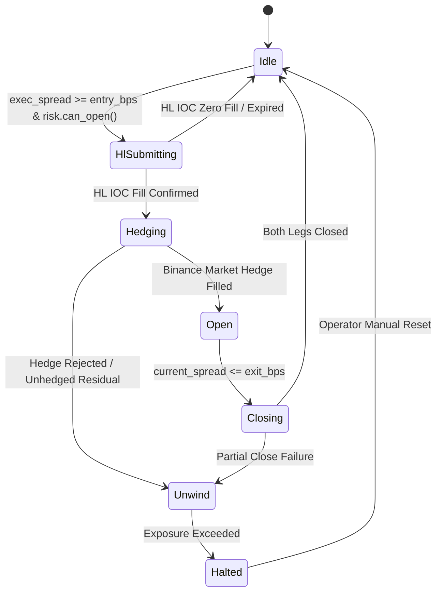

# Nautilus Arbitrage Engine (`nautilus_arb`)

High-performance, institutional-grade cross-venue arbitrage engine written in **Rust**, architected around **NautilusTrader 2.0** design principles and porting the production-tested trading, WAL, and risk mechanics from `D:\hedg-arb`.

---

## 1. Architecture Overview

The system is organized as a high-efficiency Cargo workspace with zero garbage-collection overhead and nanosecond-precision monotonic timing.

```
d:\nautilus_arb/
├── Cargo.toml                       # Workspace manifest
├── config/
│   └── config.toml                  # Strategy, risk, and venue configuration
├── crates/
│   ├── arb-core/                    # Domain models, monotonic clocks, math & edges, risk, WAL
│   │   ├── src/types.rs             # L1 quotes, order intents, fills, positions, trades
│   │   ├── src/clocks.rs            # Monotonic timing & venue latency tracking
│   │   ├── src/math.rs              # Basis calculation, executable spread, IOC slippage
│   │   ├── src/risk.rs              # Pre-trade checks, unhedged exposure, circuit breakers
│   │   ├── src/state.rs             # Finite State Machine & engine snapshot
│   │   └── src/wal.rs               # Write-Ahead Log (WAL) & atomic state persistence
│   ├── arb-strategy/                # Nautilus-compatible trading strategies
│   │   ├── src/traits.rs            # ArbitrageStrategy trait
│   │   ├── src/strategy.rs          # CrossVenueArbStrategy (Binance vs Hyperliquid)
│   │   ├── src/signals.rs           # StrategySignal definitions (Enter, Hedge, Exit, Unwind)
│   │   ├── src/funding.rs           # Multi-venue funding rate calibration
│   │   └── src/nautilus_adapter.rs  # Adapter for NautilusTrader Strategy + DataActor
│   ├── arb-engine/                  # Execution orchestrator & orderbook sync
│   │   ├── src/engine.rs            # Event loop & state transition coordinator
│   │   ├── src/executor.rs          # ExecutionClient trait abstraction
│   │   ├── src/dry_run.rs           # Top-of-book simulated execution
│   │   ├── src/orderbook.rs         # Binance diff stream & REST snapshot reconciler
│   │   └── src/reconcile.rs         # Startup position & order reconciler
│   └── arb-runner/                  # CLI application binary
│       ├── src/main.rs              # Entry point & command routing
│       ├── src/cli.rs               # Clap CLI argument parser
│       └── src/config.rs            # TOML config loader
```

---

## 2. Flagship Strategy: Binance USDⓈ-M vs Hyperliquid HIP-3 Arbitrage

The first implemented strategy reproduces the cross-venue arbitrage from `D:\hedg-arb`:
- **Leg 1**: Hyperliquid HIP-3 DEX contract (e.g. `xyz:SKHY`).
- **Leg 2**: Binance USDⓈ-M Perpetual (`TRADIFI_PERPETUAL`, e.g. `SKHYUSDT`).

### Execution State Machine



1. **Spread Detection**:
   $$\text{mid\_basis\_bps} = \frac{\text{bn\_mid} - \text{hl\_mid}}{\text{avg\_mid}} \times 10,000$$
   $$\text{exec\_spread\_bps} = \frac{\text{bn\_bid} - \text{hl\_ask}}{\text{avg\_mid}} \times 10,000$$
2. **First Leg (HL IOC)**:
   - When $\text{exec\_spread} \ge \text{entry\_spread\_bps}$ (e.g. 50 bps), places an IOC Buy order on Hyperliquid at $\text{ask} \times (1 + \text{slippage})$.
   - Order intent is logged in WAL *before* network dispatch.
3. **Second Leg (BN Market Hedge)**:
   - Upon receiving the HL fill event, the engine instantly issues a Market Sell hedge on Binance for the exact filled quantity.
   - Once confirmed, state transitions to `Open`.
4. **Basis Convergence & Exit**:
   - Monitors quote convergence. When basis reverts to $\le \text{exit\_spread\_bps}$ (e.g. 10 bps), both legs are unwound simultaneously.

---

## 3. Reliability & Risk Protections

- **Write-Ahead Log (WAL)**:
  - `wal-intents.jsonl`: Intent logged before any order is submitted.
  - `wal-events.jsonl`: Execution fills and cancels appended immediately.
  - `trades.jsonl`: Completed roundtrips with gross/net PnL and fees.
  - `state.json`: Atomic state snapshots written to temporary files and atomically renamed.
- **Orderbook Reconciler**:
  - Implements Binance's buffer-and-replay synchronization (`lastUpdateId` / `pu == prev_u` sequence continuity check) to ensure zero stale quotes.
- **Circuit Breakers**:
  - Pre-trade risk checks limit position sizing, single-order chunk size, and unhedged delta.
  - Trips circuit breaker on repeated venue reject/timeout failures or max drawdown.

---

## 4. Usage & CLI Commands

### Run Engine (Dry-Run / Live)
```bash
cargo run -p arb-runner -- run --config config/config.toml
```

### Check Connectivity & Balances
```bash
cargo run -p arb-runner -- check --config config/config.toml
```

### Inspect Local WAL State & Reconcile
```bash
cargo run -p arb-runner -- reconcile --config config/config.toml
```

### Run Unit Tests
```bash
cargo test --workspace
```
